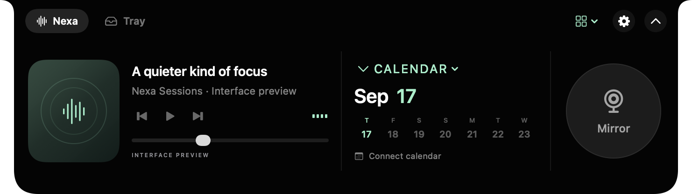
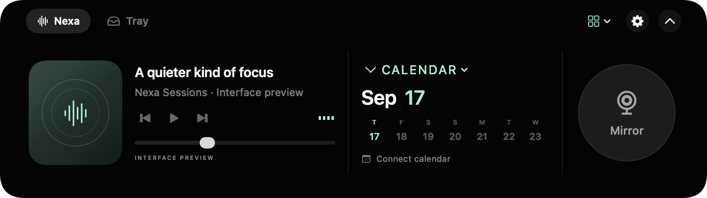
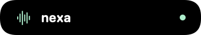

# Nexa

**A little more space.** An original native macOS notch companion built with Swift, SwiftUI and AppKit. No Electron, accounts, analytics, license checks or runtime downloads.



Version **0.3.0** is the final build from this polish pass. It adds quicker hover response, uninterrupted menu opening, widget crossfades and consistent button feedback. Device reads and media decoding run away from the interface thread. Inactive layers no longer intercept clicks or create duplicate share pickers; Reduce Motion takes effect during an active transition. Existing custom gesture timing, permissions and saved data are preserved.

The wide Home panel, system-wide Now Playing, opt-in camera mirror, notes, to-dos, Shortcuts and Tray remain included. See [final release notes](Documentation/RELEASE-0.3.0.md) for verified changes and remaining platform limits.

See [motion validation](Documentation/MOTION-VALIDATION.md) for the measured before/after results and the limits of the benchmark.

See [NotchNook research and feature coverage](Documentation/FEATURE-COVERAGE.md) for the comparison and remaining differences.

The screenshot is rendered by the running app. Its music content is explicitly labeled as an interface preview. The ordinary app starts with an honest empty state until you connect a supported player.

## Start using it

1. Download **Nexa-0.3.0.dmg** from [GitHub Releases](https://github.com/Hasindu23/Nexa/releases/latest), drag **Nexa** to **Applications**, then open it.
2. Follow the welcome flow or select **Set up later**. No private-data permission is requested automatically.
3. Hover over or click the top-center notch. On a Mac without a notch, use the top pill.
4. Use the waveform menu bar icon for Open Nexa, Pause, Keep Awake, Settings and Quit.
5. Home has media, a configurable center widget and Mirror. The grid button opens all widgets; Tray holds files.
6. Click **Mirror** to grant Camera access and start a preview. Click again to stop; collapsing Nexa also stops the camera.
7. Choose Shortcuts in the center widget menu, then star shortcuts in the Shortcuts module.
8. Drop files into Tray; select several to copy or AirDrop, or use the eye button for Quick Look.

Clipboard capture, media connection, camera use, Bluetooth, Weather and Assistant connections are opt-in. Local-only mode is on by default. The app continues running after you close Settings. Reopening the app opens Settings, including if you have hidden the menu bar icon.

This is a locally signed development build, not a notarized commercial release. The included source is the reproducible path for other Macs; a seamless verified distribution requires Developer ID signing and Apple notarization. No developer account is needed to build and run locally.

If macOS blocks this downloaded build, use the source to build locally or review [Apple's instructions for opening an unnotarized app](https://support.apple.com/102445). Only use **System Settings → Privacy & Security → Open Anyway** if you trust the release. Nexa does not require disabling Gatekeeper.

### Mac mini and displays without a notch

Nexa automatically uses a small rounded panel at the top center. Hover or click to expand it. Adjust **Settings → General → Pill position** to move it horizontally. macOS **15 or later** is required; the download includes Apple Silicon and Intel binaries. The notch-free layout is covered by native simulation and geometry tests; it has not been run on a separate physical Mac mini. Mirror requires an available built-in, external or Continuity camera.

## Included

| Area | Implemented behavior |
| --- | --- |
| Notch | Hardware detection, top pill fallback, calibrated width, hover/click opening, smooth interruptible expansion, delayed collapse, Escape, context menu, optional scroll navigation, Spaces/full-screen flags |
| Now Playing | System-wide Now Playing, including reporting browsers and native apps; artwork, source selection, scrubbing, previous/play/pause/next, volume, live playback indicators; Music/Spotify fallback |
| Mirror | On-click AVFoundation camera preview, built-in/external/Continuity camera selection, horizontal mirroring, automatic shutdown on collapse/pause/module exit |
| Notes / To-dos | Local saved notes and pins; favorite to-dos, completion and recoverable automatic archive after 24 hours |
| Shortcuts | List and run Apple Shortcuts, favorite two for Home, explicit stop control |
| File shelf | Original-file references, Quick Look previews/thumbnails, multiple-file selection, copy/paste, direct AirDrop drop zone, Finder reveal, native sharing, drag out, deduplication, expiry, session-only or persistent shelf |
| Clipboard | Opt-in local text/URL/image/file history, search, pin, copy again, delete/clear, privacy pause, size limits, standard concealed/transient type filtering |
| Calendar | EventKit permission, next seven days, time until event, five-minute banners, opening events through Calendar automation |
| Reminders | Permission-based list, due-today filter, complete, create in the default list, optional due-today date |
| Timers | 5/15/25-minute presets, custom duration up to 24 hours, pause/resume/reset, stopwatch, deadline-based countdown, completion banner and optional sound |
| Quick controls | Output volume/mute where supported, Wi-Fi power status, keep awake, screenshot toolbar, optional Accessibility-backed lock shortcut, system settings shortcuts |
| System | Battery/charging, system CPU, active/wired/compressed memory estimate, free storage, public thermal state |
| Bluetooth | Paired device names and connection status; connection/disconnection notifications while enabled |
| Weather | Optional Open-Meteo request, chosen coordinates, temperature/condition/high/low, Celsius/Fahrenheit, manual refresh |
| Assistant | Optional OpenAI Responses API, user key in Keychain, reviewable input, summarize/rewrite/explain/translate, cancel, copy response |
| Sharing | macOS ShareLink / sharing picker for files, dropped images and text; destinations depend on available system services |
| Settings | General, appearance, modules, gestures, privacy, weather, assistant, About, manual configurable release-feed checker |

## Build and test

Requirements: macOS 15+, Xcode 16+ with macOS SDK, Swift 5 language mode or newer compiler. This project was built and tested with Xcode 26.6 on Apple Silicon, macOS 26.5.1. The deployment target is macOS 15; earlier supported OS versions and Intel require separate device validation.

Open `Nexa.xcodeproj`, select **Nexa → My Mac**, and Run. Signing defaults to **Sign to Run Locally**; there are no package downloads. A vendored BSD-licensed MediaRemote Adapter is compiled from source by a build phase; no separate package manager is needed.

Or use the included scripts:

```sh
./Scripts/build.sh Release --open
./Scripts/test.sh
```

Build products go under your temporary directory to avoid iCloud/File Provider metadata invalidating code signatures in Documents folders. Source and screenshots stay in this project. If you prefer Xcode, its normal DerivedData folder also avoids this problem.

Regenerate the checked-in project after adding source files, if desired:

```sh
python3 Scripts/generate-project.py
```

The shared scheme includes an XCTest target. The built app also has an isolated smoke-check mode:

```sh
/path/to/Nexa.app/Contents/MacOS/Nexa --qa-output /tmp/NexaPreview
```

That mode uses isolated settings and temporary sample files, performs native UI actions, produces screenshots and a result report, then exits. It never enables private-data connections or uses the system clipboard. `--settings` and `--expanded` are normal launch conveniences.

For repeatable open/close and interruption checks, run `Nexa --qa-motion /tmp/nexa-motion.txt` using the built executable. This reports native resize counts and main-loop heartbeat delays, not rendered display FPS.

## Project map

- `Nexa/App/`: application lifecycle, menu bar, onboarding, native smoke checks.
- `Nexa/Core/`: composition/lifecycle, banners, local storage.
- `Nexa/Notch/`: geometry, non-activating panel, hover delays, root navigation/drop handling.
- `Nexa/Modules/`: individual services and SwiftUI views.
- `Nexa/Settings/`: preferences UI and privacy/integration setup.
- `Nexa/Services/`: output controls, networking, Keychain, manual update checking.
- `Nexa/Models/`: typed preferences and module definitions.
- `Nexa/Utilities/`: shared visual components.
- `NexaTests/`: deterministic behavior, privacy and data-preservation tests.

See [architecture](Documentation/ARCHITECTURE.md), [permissions and privacy](Documentation/PRIVACY.md), [known limitations](Documentation/LIMITATIONS.md), and [validation](Documentation/VALIDATION.md).

## Rename / publish

The temporary product name is Nexa and the bundle ID is `app.nexa.mac`. Change the generator’s product/bundle settings, Info.plist display metadata, visible strings, UserDefaults/application-support namespace and Keychain service name together before distributing a renamed app. Changing storage identifiers creates a separate data store; plan a migration if existing user data should be preserved.

The public repository and downloads are at [Hasindu23/Nexa](https://github.com/Hasindu23/Nexa). The optional manual update checker accepts an HTTPS JSON release feed; the release is never installed automatically. A release feed looks like:

```json
{"version":"0.3.0","url":"https://github.com/Hasindu23/Nexa/releases/tag/v0.3.0"}
```

The checker compares versions and opens the release page. It does not download executable code or replace the app. Use Developer ID signing, hardened runtime and Apple notarization for distribution; follow your own trusted release process.

MIT-licensed original source. SF Symbols and Apple framework assets are supplied by the OS. Open-Meteo attribution is shown in the app; its free hosted service is intended for non-commercial use.

## Third-party notice

System media uses [MediaRemote Adapter](https://github.com/ungive/mediaremote-adapter), BSD 3-Clause, copyright Jonas van den Berg and contributors. The pinned revision, complete license and source are under `ThirdParty/mediaremote-adapter`. Nexa uses private macOS media APIs through that local helper; OS updates can affect support. No NotchNook code or assets are included.

## Notch-free preview

This native preview uses simulated display geometry for a Mac mini or another display without a notch.




